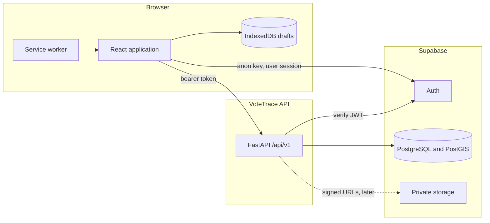

# Architecture

VoteTrace is an offline-first platform for electoral evidence and polling-unit result verification. This repository is the foundation: application shells, a design system, API and database structure, and the security boundaries later features must keep.

The tagline is "Every Vote, Every Voice."

## System shape

The browser never receives the database URL, the JWT secret, or the Supabase service-role key. Those exist only in the API environment.

## Frontend

`frontend/` is a Vite, React and TypeScript application.

- Routes live in `src/app/routes.tsx`. Public pages and the admin shell are separate trees.
- `src/app/navigation.ts` is the single list of destinations. Admin entries carry the roles allowed to see them, and the route guards read that same list.
- `src/features/auth` verifies a Supabase session and reads roles from `app_metadata`. The UI uses that to show or hide areas. It is not the authorization boundary.
- `src/lib/api-client.ts` calls the API. Authenticated requests attach the current access token. The client understands the API error envelope.
- `src/lib/offline/db.ts` is the Dexie database. It holds incident drafts (uploaded by `features/public/incidents/drafts.ts` when online, then stripped of content), an `apiCache` of public read-only responses, and an `outbox`. Dexie is loaded on first use, so it is not in the initial bundle.
- `src/lib/offline/public-cache.ts` fetches public data without credentials and saves each response with the server's `generated_at`. A response is written only if it is at least as new as the saved copy. When the server is unreachable, the saved copy is returned marked `origin: 'cache'` with its last-synced time. Client errors (404, 422) are never masked by the cache.
- `src/lib/offline/sync-engine.ts` queues a `public_refresh` for each page served from the cache. It replays the queue on the `online` event, then refreshes the visible queries. The offline banner shows the offline, syncing and retry states. Only idempotent re-fetches are queued.
- `src/features/directory` holds the API types, query hooks, the cascading State, LGA and Ward selector, and the demo and freshness notices. `src/features/polling-units`, `src/features/updates` and `src/features/results` are the public modules. Their pages are code-split, and Leaflet loads only when a user opens the map.
- `src/features/results` is the results dashboard (see [results-aggregation.md](results-aggregation.md)). One lazily loaded section serves `/results` and `/admin/results`. Data goes through the public cache, so saved copies are labelled as not live. `useLiveAnalytics` subscribes to the Server-Sent Events stream and refetches only affected queries. Charts are SVG and CSS. The state map loads Leaflet and the bundled boundary GeoJSON on demand.
- The service worker precaches the application shell and the state boundary GeoJSON. It does not cache `/api/` responses or evidence files; offline data comes from IndexedDB as above. A new version asks before it reloads the page.

Pages that do not have their backing data yet render an explicit empty state. They do not show sample results.

## Backend

`backend/app` is a FastAPI application.

- `core/config.py` loads settings from the environment. Production refuses to start without a database URL, a JWT secret and an explicit CORS list.
- `core/errors.py` turns every failure into `{ "error": { "code", "message", "request_id" } }`. Validation errors drop the submitted value so a password cannot be echoed back.
- `core/security.py` verifies Supabase access tokens with HS256 and the project JWT secret. Roles are taken only from `app_metadata`. `user_metadata` and the top-level `role` claim are ignored.
- `core/logging.py` writes JSON logs and redacts bearer tokens, URL passwords and secret-like fields. Database failures are logged without the exception text, because that text can contain the connection string.
- `db/models.py` is the relational model. `db/session.py` opens a connection only when `DATABASE_URL` is set.
- `api/v1` exposes a health check, the signed-in principal and an admin session check. It also has the public directory: `GET /locations/states`, `/locations/lgas?state_id=`, `/locations/wards?lga_id=`, `/polling-units` (filters `state_id`, `lga_id`, `ward_id`, `q`, `code`, `status`, plus `page` and `page_size`), `/polling-units/{id}`, `/updates` (filters `category`, `verification_status`, `published_from`, `published_to`) and `/updates/{id}`. `POST /admin/updates` is for `election_admin` and `system_admin`. The other write routes are the authenticated `/evidence` routes. No route accepts a status from the client or edits incidents.
- `evidence/` is the evidence engine: content-based image validation, hashing, storage (local directory or private Supabase bucket), preprocessing, the OCR provider interface, template field mapping, deterministic validation, comparison, `ai/` (VoteTrace AI anomaly detection), the hash-chained audit trail, and workflow transitions. `service.py` orchestrates them. See [evidence-engine.md](evidence-engine.md).
- `analytics/` is result aggregation: the reconciliation policy, per-polling-unit refresh inside the committing transaction (SQLAlchemy session hooks), hierarchy and coverage queries, the in-process event broker, and the demo seed. `api/v1/analytics.py` exposes the public read-only `/analytics/*` routes, the `/analytics/updates` event stream and the admin rebuild route. See [results-aggregation.md](results-aggregation.md).
- `directory/repository.py` defines the `DirectoryRepository` interface that routes depend on. `DemoDirectoryRepository` serves the fictional dataset in `directory/demo_data.py`. `DatabaseDirectoryRepository` (`directory/database.py`, the default `DIRECTORY_SOURCE=database`) serves the register imported with `directory/importer.py`, and the elections and updates stored by administrators. See [data-sources.md](data-sources.md).
- `schemas/` holds the Pydantic response models. Every directory response includes `data_source` and `generated_at`. `PollingUnitDetail` refuses `officially_relocated` without a confirmed, sourced relocation notice.
- `incidents/` is incident reporting: rule-based triage (`triage.py`), the status workflow and public bands (`workflow.py`), and submission, review, statistics and publication (`service.py`). `api/v1/incidents.py` exposes the routes. See [incidents-and-channels.md](incidents-and-channels.md).
- `channels/` holds the read-only basic-phone channels. `info.py` (`InfoService`) is shared by USSD, SMS and `/public/election-updates`, and reads results only through `analytics.queries`. `ussd.py` holds the menu state machine, the session store and the gateway adapter. `sms.py` holds the command parser, paging and rate limiting. `security.py` handles signatures and phone hashing. `api/v1/channels.py` exposes the routes.
- `core/rate_limit.py` is an in-process sliding-window limiter applied to `/api/v1`.

Alembic is configured in `backend/alembic`. Revision `0001_initial` enables `pgcrypto` and `postgis`, then creates the tables from the SQLAlchemy metadata. Revision `0002_append_only` adds append-only triggers and row-level security to the evidence history tables. Revision `0003_result_aggregation` adds `states.iso_code` and the derived `polling_unit_results` and `polling_unit_result_metrics` tables, with row-level security and no grants to `anon` or `authenticated`. Revision `0004_incidents_and_channels` adds `incident_reports`, `incident_attachments`, `incident_reviews` and `sms_messages`, and replaces the unused prototype incident table.

## Request path

1. The browser sends `Authorization: Bearer <supabase access token>` to `/api/v1/...`.
2. Middleware assigns an `X-Request-ID` and security headers. CORS allows only the configured origins and does not allow credentialed cookies.
3. A protected route verifies the token. If the secret is not configured, the route returns 503 rather than accepting the token.
4. `require_roles` rejects principals that lack one of the allowed roles.
5. Evidence write routes open a database session, persist the change, and append a hash-chained `audit_events` row for the submission.

## What is deliberately left out

A connected USSD or SMS provider, importing the official polling-unit register, persisting published updates, and staff administration are later tasks. The pages and tables reserve a place for them without pretending they already work.
