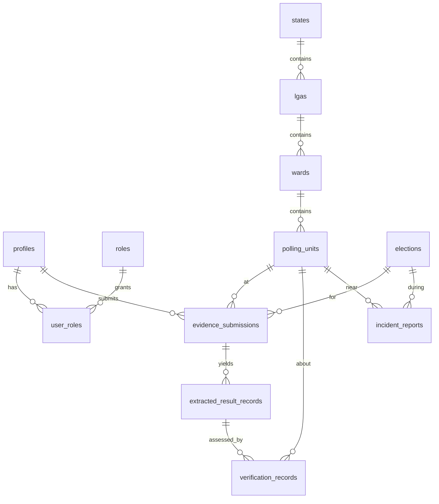

# Data model

> **Superseded.** This page describes an earlier layout (`profiles`, `user_roles`, `app/models`) that the code no longer uses. The current schema is in [data-model.md](data-model.md) and the current RLS statements are in [security.md](security.md).

The SQLAlchemy models in `backend/app/models/` define the storage shape of every planned
entity. They contain no business logic. No migration has been generated yet; create it with
`alembic revision --autogenerate` once a database is connected (see the README).

| Entity | Table | Notes |
| --- | --- | --- |
| Users | `profiles` | Primary key equals `auth.users.id`. Identity and credentials stay in Supabase Auth. |
| Roles | `roles`, `user_roles` | Grant history, including who granted each role. Mirrored into JWT `app_metadata`. |
| Elections | `elections` | Name, type, date and status (`scheduled`, `in_progress`, `concluded`). |
| States / LGAs / Wards | `states`, `lgas`, `wards` | INEC codes, unique within their parent. |
| Polling units | `polling_units` | Full delimitation code (unique) and a PostGIS `POINT(4326)` location with a GiST index. |
| Evidence submissions | `evidence_submissions` | Private storage path, SHA-256, size and MIME type, capture time, and a client idempotency key. |
| Extracted result records | `extracted_result_records` | Party votes (JSONB) and the sheet totals. `extraction_method` is `manual` or `ocr`. |
| Verification records | `verification_records` | **Append-only** decision history. The current status is the latest row per (election, polling unit). |
| Audit events | `audit_events` | Append-only, identity primary key, actor, action, entity, request ID and metadata (JSONB). |
| Incident reports | `incident_reports` | Category, description, optional location and polling unit, status, and a client idempotency key. |

## Conventions

- UUID primary keys generated by Postgres (`gen_random_uuid()`), except `audit_events`, which
  uses a bigint identity column so events are strictly ordered.
- All timestamps are `timestamptz`, with server-side defaults.
- Constraint names are deterministic (see `NAMING_CONVENTION` in `app/db/base.py`).
- Status columns use native Postgres enums whose values mirror the Python `StrEnum`s in
  `app/models/enums.py`.
- Server-owned fields (`status`, `decided_by`, `extracted_by`) are never accepted from request bodies.

## Migration checklist (first run)

1. `create extension if not exists postgis;`
2. Autogenerate the migration, then add by hand:
   - `profiles.id` foreign key to `auth.users(id) on delete cascade`;
   - seed rows for `roles` (`observer`, `reviewer`, `auditor`, `election_admin`, `system_admin`).
3. `alembic upgrade head`.
4. Apply `docs/supabase/rls_policies.sql`.
